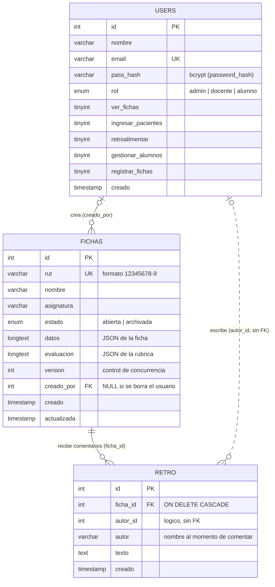

# Diagrama Entidad-Relación

Base de datos `ficha_tens` (MySQL / MariaDB, motor InnoDB, `utf8mb4`). Se crea con `api/install.php`.

## Tablas

### `users`
| Campo | Tipo | Notas |
|---|---|---|
| `id` | INT UNSIGNED PK AI | |
| `nombre` | VARCHAR(120) | |
| `email` | VARCHAR(160) UNIQUE | Se usa para iniciar sesión (ej. `maria@tens.cftohiggins.cl`). |
| `pass_hash` | VARCHAR(255) | Hash bcrypt. Nunca se guarda la contraseña. |
| `rol` | ENUM | `admin` = Jefa de carrera, `docente`, `alumno` = Estudiante. |
| `ver_fichas` | TINYINT(1) | Permiso del docente. |
| `ingresar_pacientes` | TINYINT(1) | Permiso del docente. |
| `retroalimentar` | TINYINT(1) | Permiso del docente. |
| `gestionar_alumnos` | TINYINT(1) | Permiso del docente. |
| `registrar_fichas` | TINYINT(1) | Permiso del estudiante. |
| `creado` | TIMESTAMP | |

Valores por defecto al crear: docente con sus 4 permisos en 1; estudiante con `registrar_fichas` en 1. La jefa de carrera no usa estas columnas (tiene acceso a todo).

### `fichas` (una por paciente)
| Campo | Tipo | Notas |
|---|---|---|
| `id` | INT UNSIGNED PK AI | |
| `rut` | VARCHAR(12) UNIQUE | RUN ficticio normalizado, sin puntos. La restricción UNIQUE garantiza una sola ficha por paciente. |
| `nombre` | VARCHAR(120) | Nombre ficticio del paciente. |
| `asignatura` | VARCHAR(120) | Se usa para el listado por asignatura. |
| `estado` | ENUM | `abierta` (se puede registrar) o `archivada` (lista para revisión). |
| `datos` | LONGTEXT (JSON) | Contenido clínico. Ver estructura abajo. |
| `evaluacion` | LONGTEXT (JSON) | Rúbrica del docente. |
| `version` | INT UNSIGNED | Sube en cada guardado. Evita que dos personas se pisen. |
| `creado_por` | INT UNSIGNED NULL FK → `users.id` | `ON DELETE SET NULL`: la ficha se conserva si se elimina al usuario. |
| `creado`, `actualizada` | TIMESTAMP | `actualizada` se actualiza sola. |

### `retro`
| Campo | Tipo | Notas |
|---|---|---|
| `id` | INT UNSIGNED PK AI | |
| `ficha_id` | INT UNSIGNED FK → `fichas.id` | `ON DELETE CASCADE`: los comentarios se borran con la ficha. |
| `autor_id` | INT UNSIGNED NULL | Referencia lógica al usuario (sin FK) para no perder el comentario si se elimina la cuenta. |
| `autor` | VARCHAR(120) | Nombre del autor al momento de comentar. |
| `texto` | TEXT | Máx. 2000 caracteres (validado en el servidor). |
| `creado` | TIMESTAMP | |

## Estructura del JSON `fichas.datos`
Los datos clínicos van en JSON porque la ficha tiene muchas secciones y tablas de registros repetidos (basada en la planilla `Ficha_Clinica_Simulacion_TNS.xlsx`). Las columnas buscables (RUN, nombre, asignatura, estado) quedan fuera del JSON.

| Clave | Contenido |
|---|---|
| `caso`, `fecha`, `hora`, `estudiantes`, `docente`, `grupo`, `rol` | A. Datos de la actividad |
| `nacimiento`, `sexo`, `civil`, `prevision`, `ocupacion`, `educacion`, `domicilio`, `contacto`, `telefono` | B. Identificación del usuario simulado |
| `ingreso`, `via`, `unidad`, `diagnostico`, `motivo` | C. Motivo de consulta e ingreso |
| `morbidos`, `quirurgicos`, `alergias`, `medhab`, `familiares`, hábitos | D. Antecedentes y hábitos |
| `peso`, `talla`, `cintura`, `conciencia` | E. Antropometría (IMC y edad se calculan) |
| `exam` | F. Examen físico segmentario (9 segmentos: estado y observaciones) |
| `disp` | G. Dispositivos y vías (6 filas) |
| `problemas`, `cuidados`, `firmaEst`, `firmaDoc` | I y J |
| `vitales[]` | Registros de signos vitales (PAS, PAD, FC, FR, T°, SatO₂, HGT, EVA, conciencia…) |
| `meds[]` | Indicaciones y administración con los 5 correctos |
| `notas[]` | Notas de enfermería con V°B° docente |
| `balance[]` | Balance hídrico (ingresos y egresos) |
| `esc` | Escalas: `gl` (Glasgow), `br` (Braden), `dw` (Downton) |

`fichas.evaluacion`: `{ estudiante, docente, fecha, p: {0..11}, o: {0..11}, texto }` (puntajes y observaciones por criterio, y retroalimentación general).

## Reglas de integridad
- Una ficha por paciente (`rut` UNIQUE).
- Al eliminar un usuario, sus fichas se conservan (`creado_por` pasa a NULL).
- Al eliminar una ficha, se eliminan sus comentarios (`retro`) en cascada.
- Los valores calculados (edad, IMC, PAM, totales, notas) no se guardan: se recalculan al abrir la ficha.
