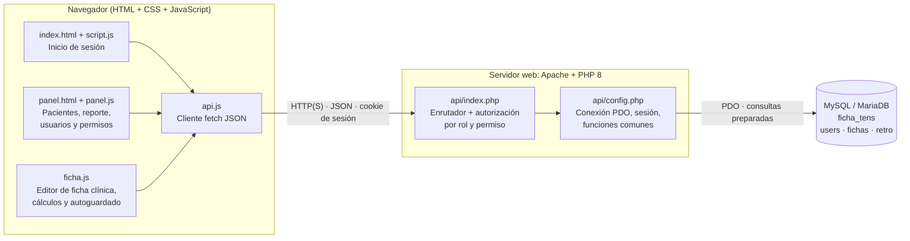
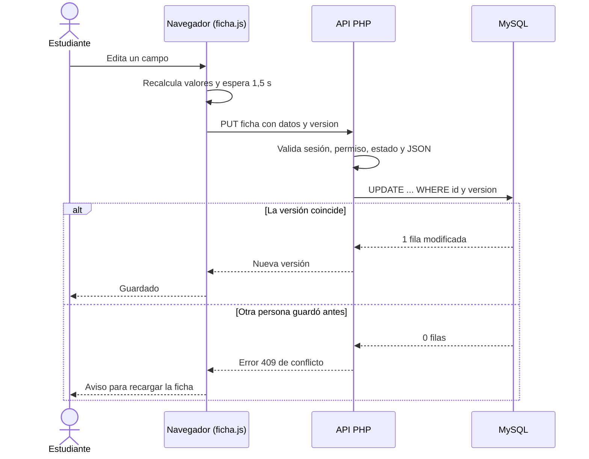

# Arquitectura del sistema

Aplicación web de **3 capas** (presentación, API/lógica, datos) sin frameworks: HTML + CSS + JavaScript en el navegador, PHP sobre Apache, y MySQL/MariaDB.

## Vista general

## Capas y responsabilidades

| Capa | Archivos | Responsabilidad |
|---|---|---|
| Presentación | `index.html`, `panel.html`, `style.css`, `panel.css` | Estructura y estilos. Diseño para escritorio y notebook; el panel se adapta a pantallas pequeñas. Incluye estilos de impresión para exportar la ficha a PDF. |
| Lógica de cliente | `script.js`, `panel.js`, `ficha.js`, `api.js` | Login, búsqueda, formularios, editor de ficha, cálculos automáticos (edad, IMC, PAM, alertas, 5 correctos, balance, escalas, nota de rúbrica) y autoguardado. |
| API | `api/index.php`, `api/config.php` | Autenticación, **autorización en el servidor** por rol y permiso, validación de datos, acceso a la base de datos. |
| Datos | MySQL / MariaDB | Persistencia (ver `diagrama-er.md`). |
| Instalación | `api/install.php` | Crea la base y las tablas y genera la cuenta de jefatura. Solo desde `localhost`; **se debe borrar después de usarlo**. |

## Rutas de la API (`api/index.php?r=…`)

Todas devuelven JSON. Las peticiones POST, PUT y DELETE exigen `Content-Type: application/json`. Salvo `login`, todas requieren sesión iniciada.

| Ruta | Método | Función | Quién puede |
|---|---|---|---|
| `login` | POST | Inicia sesión | Cualquiera |
| `me`, `logout` | GET / POST | Usuario actual / cerrar sesión | Sesión iniciada |
| `users` | GET | Lista usuarios | Jefa: todos · Docente (con permiso): estudiantes · Estudiante: solo él |
| `users` | POST / PUT / DELETE | Crear, editar, eliminar | Jefa; Docente solo sobre estudiantes y con `gestionar_alumnos` |
| `permisos` | PUT | Cambiar un permiso | Solo jefa |
| `fichas` | GET | Lista con búsqueda (`q`) y filtros (`estado`, `creador`) | Jefa y docente con `ver_fichas`: todas · Estudiante: solo las que creó |
| `creadores` | GET | Usuarios que han creado fichas (para el filtro) | Jefa y docente con `ver_fichas` |
| `ficha` | GET | Abre una ficha con sus comentarios | Igual que la lista (el estudiante solo abre las suyas) |
| `ficha` | POST | Ingresa un paciente | Jefa; docente con `ingresar_pacientes`; estudiante con `registrar_fichas` |
| `ficha` | PUT | Guarda la ficha (con `version`) | Jefa; docente con `ingresar_pacientes`; estudiante con `registrar_fichas` solo si es suya y está abierta |
| `ficha` | DELETE | Elimina la ficha | Solo jefa |
| `estado` | PUT | Archivar / reabrir | Estudiante: solo archivar sus fichas · Docente (`ingresar_pacientes` o `retroalimentar`) y jefa: ambos |
| `retro` | POST / DELETE | Comentar / borrar comentario | Jefa; docente con `retroalimentar` (borrar: autor o jefa) |
| `evaluacion` | PUT | Guarda la rúbrica | Jefa; docente con `retroalimentar` |

## Decisiones de diseño

- **Autorización siempre en el servidor.** El front oculta botones por comodidad, pero cada ruta vuelve a verificar rol y permiso.
- **Sesión por cookie** (`httponly`, `SameSite=Lax`) con regeneración del identificador al iniciar sesión.
- **Contraseñas con bcrypt** (`password_hash` / `password_verify`) y consultas SQL preparadas (PDO).
- **Ficha clínica en JSON** dentro de `fichas.datos`: flexible para las muchas secciones de la planilla. Los campos de búsqueda y reporte son columnas normales.
- **Control de concurrencia optimista:** cada guardado envía la `version` que el usuario cargó; si otra persona guardó antes, el servidor responde 409 y no se pisan los cambios.
- **Cálculos en el cliente:** nada derivado se guarda; se recalcula al abrir.
- **PDF con el navegador:** el botón usa la impresión (`window.print`) con estilos propios; no hay librerías externas ni archivos subidos (requisito del cliente).

## Flujo de guardado con control de versión

