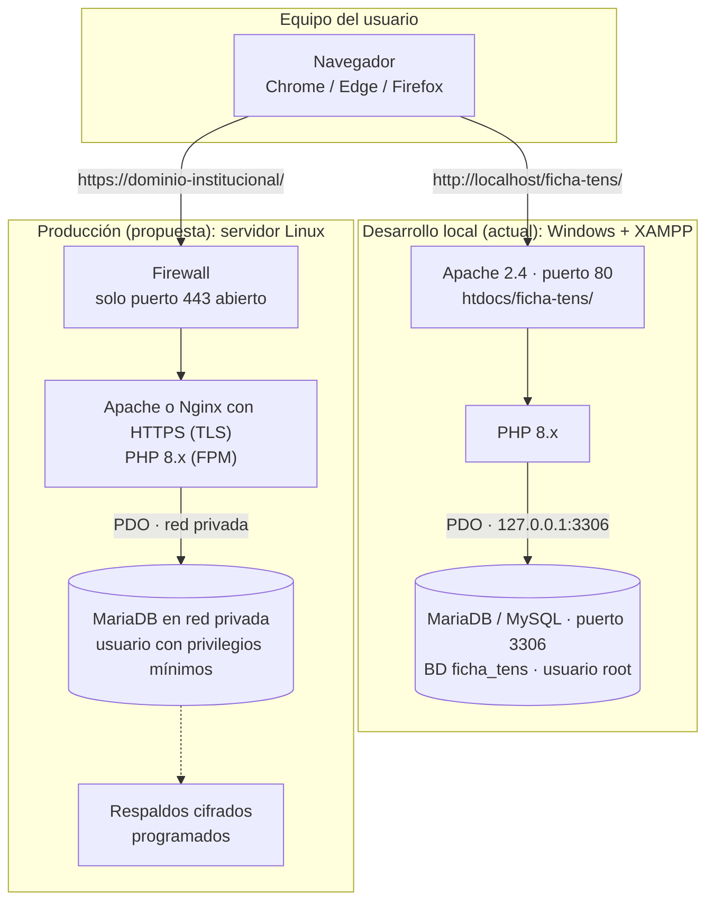

# Diagrama de despliegue

## Entornos



## Comparación

| Aspecto | Desarrollo local (hoy) | Producción (propuesta) |
|---|---|---|
| Sistema | Windows + XAMPP | Linux (servidor institucional o VPS) |
| Acceso | `http://localhost/ficha-tens/` | `https://` con certificado válido |
| Web / PHP | Apache + PHP 8.x de XAMPP | Apache o Nginx + PHP-FPM actualizados |
| Base de datos | MariaDB/MySQL, usuario `root` sin clave | MariaDB, usuario propio con permisos mínimos y clave fuerte |
| Configuración | `api/config.php` con valores por defecto | `api/config.php` con credenciales reales, idealmente fuera de la carpeta pública |
| Instalación | `api/install.php` | Ejecutar una vez y **eliminarlo** |
| Cookie de sesión | `secure` desactivado (HTTP) | `secure` activado (HTTPS) |
| Respaldos | Manual (exportar desde phpMyAdmin) | Automáticos, cifrados y con restauración probada |

## Estructura de archivos en el servidor

```
ficha-tens/                 (htdocs en XAMPP, o la carpeta pública del servidor)
├── index.html              Inicio de sesión
├── panel.html              Panel principal
├── style.css, panel.css    Estilos (incluye impresión/PDF)
├── script.js               Lógica del login
├── panel.js                Lógica del panel
├── ficha.js                Editor de la ficha clínica
├── api.js                  Cliente de la API
└── api/
    ├── config.php          Conexión a la BD y sesión
    ├── index.php           API (enrutador)
    └── install.php         Instalador (borrar tras usarlo)
```

## Pasos para llevarlo a un servidor

1. Preparar el servidor con Apache o Nginx, PHP 8.x (extensiones `pdo_mysql`, `mbstring`) y MariaDB.
2. Crear un usuario de base de datos exclusivo para la aplicación, con permisos solo sobre `ficha_tens`. Una vez creadas las tablas, basta con `SELECT, INSERT, UPDATE, DELETE`.
3. Copiar la carpeta del proyecto a la carpeta pública del servidor.
4. Editar `api/config.php`: host, nombre de BD, usuario y clave reales; activar `'secure' => true` en la cookie de sesión.
5. Ejecutar `api/install.php` desde el propio servidor (solo responde a `localhost`) para crear las tablas y la cuenta de jefatura. **Anotar la contraseña que muestra y borrar `install.php`.**
6. Activar HTTPS con un certificado válido y redirigir todo el tráfico HTTP a HTTPS.
7. Aplicar el `checklist-seguridad.md` completo antes de ingresar usuarios reales.
8. Programar respaldos de la base de datos y probar una restauración.

## Cuidados al pasar de XAMPP a servidor

- XAMPP está pensado para desarrollo, no para producción.
- Si el servidor usa otra versión de PHP o MariaDB, probar el flujo completo: login, ingreso de paciente, guardado de ficha, retroalimentación y PDF.
- El proyecto carga las tipografías desde Google Fonts. Si el servidor tendrá una política de seguridad estricta o sin salida a internet, conviene alojarlas localmente.
